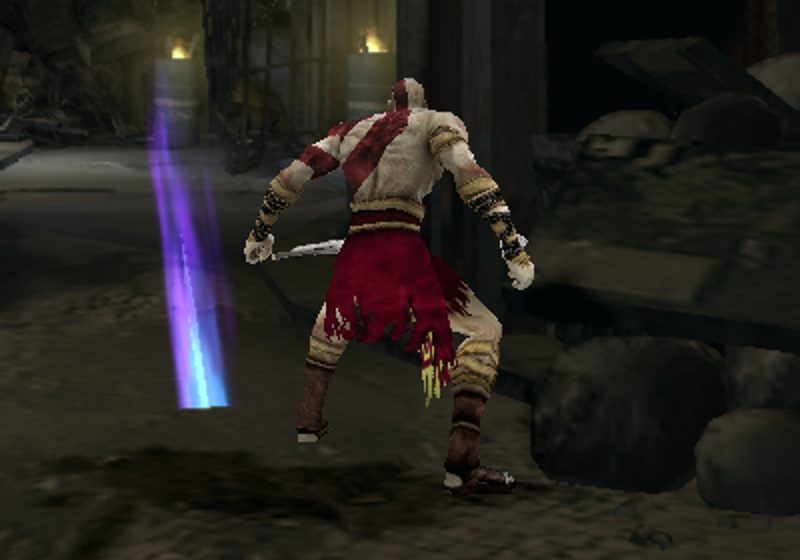
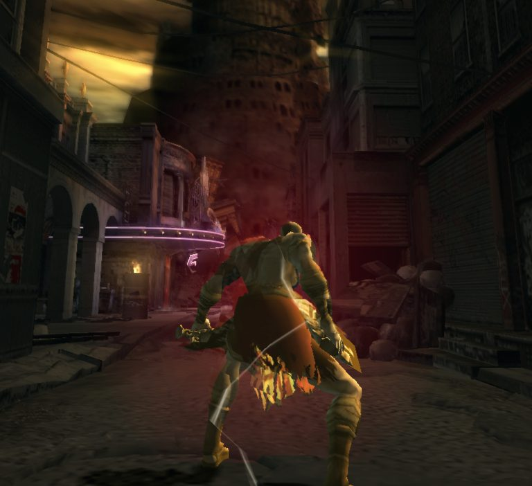
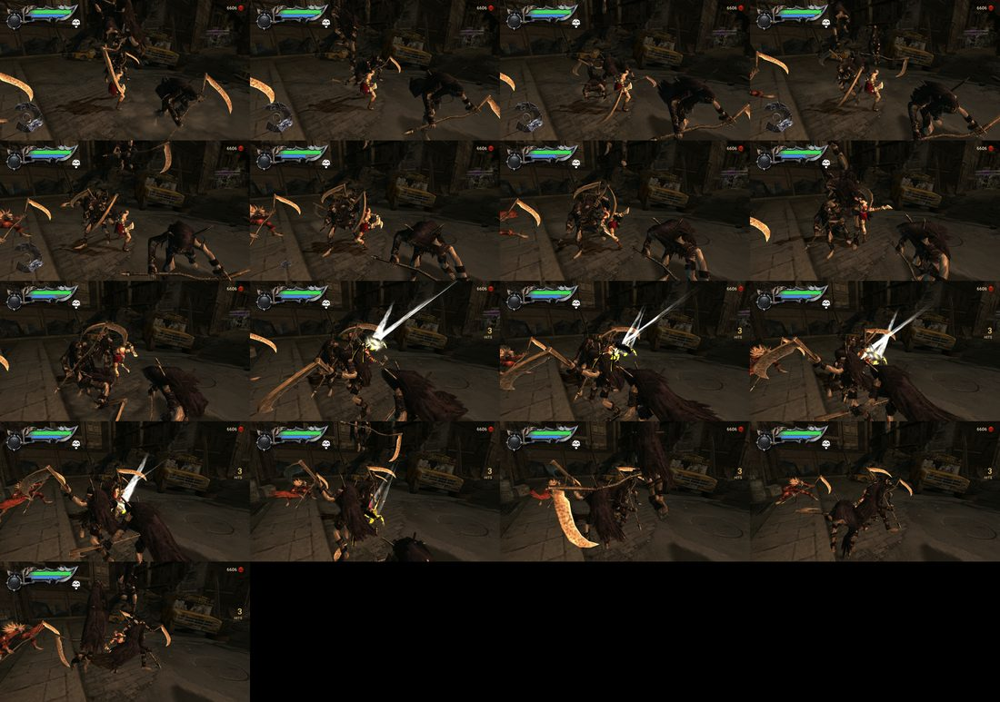
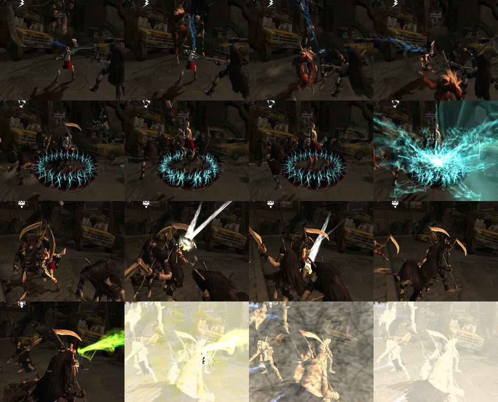
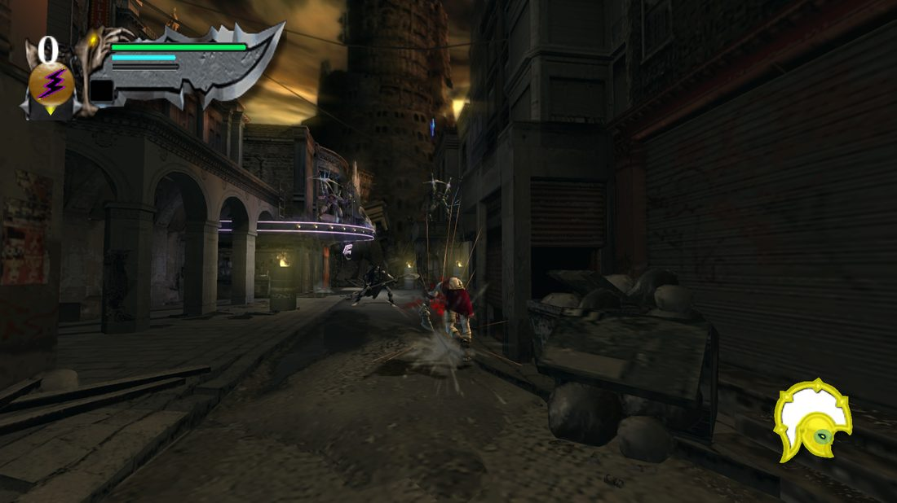
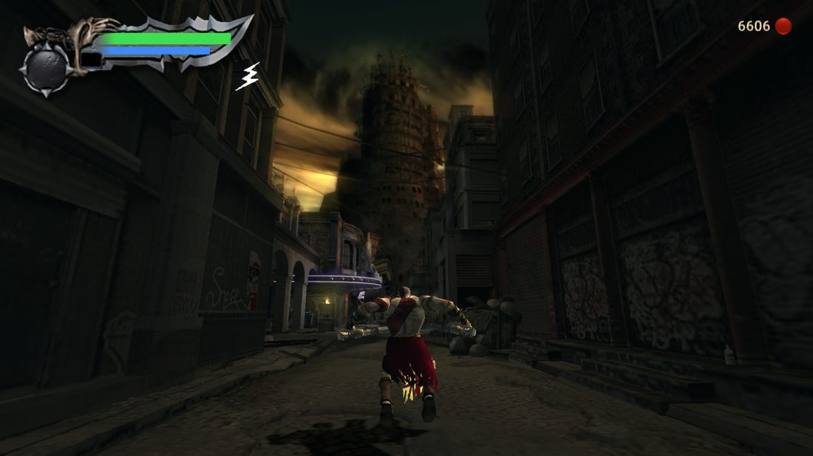

<div align="center">

# ⚔️ Kratos × Devil May Cry 3

**O Kratos do God of War (PS2, 2005) no lugar do Dante na campanha inteira do Devil May Cry 3 — HD Collection (PC).**
Modelo, Blades of Chaos, golpes, magias, Rage of the Gods, HUD e sons do GoW1 original.

 


</div>

---

## O que é

| Fonte | Destino |
|---|---|
| <br>**Devil May Cry 3: SE** (HD Collection, Steam) — fases, inimigos, chefes, câmera e história continuam | **God of War (PS2)** — o Kratos, as armas, a tabela de golpes, as magias, o HUD e os sons vêm da **sua** ISO |

Não é um port nem um emulador: o DMC3 roda nativo e uma DLL (fork do [DMC3 Crimson](https://github.com/berthrage/DMC3-Crimson))
executa o **motor de combate do GoW1** dentro dele, lendo a tabela de golpes original do jogo.

## Em ação

| Combos com a tabela original do GoW1 | Magias com os efeitos originais |
|---|---|
|  |  |
| **HUD do GoW1 (filme FLP original)** | **Campanha do DMC3** |
|  |  |

**Já funciona:** Kratos em todas as missões e roupas · Blades of Chaos e Blade of Artemis · combos no chão e no ar ·
bloqueio e parry · esquivas · agarrão com finalizações · Poseidon's Rage, Medusa's Gaze (petrifica), Zeus' Fury,
Army of Hades · Rage of the Gods · HUD, sons e vozes do GoW1 · controles do GoW1.

**Estágio e pendências:** [`docs/STATUS.md`](docs/STATUS.md).

## Instalar e testar

> ⚠️ **Nenhum arquivo da Sony ou da Capcom está neste repositório.** O instalador gera tudo a partir do jogo e da
> ISO que **você** possui. Não peça nem compartilhe arquivos extraídos.

Você precisa de: DMC HD Collection (Steam) + [Crimson 0.5a](https://github.com/berthrage/DMC3-Crimson/releases) +
ISO do God of War NTSC-U (`SCUS_973.99`) + WSL 2 no Windows.

```bash
git clone --recursive https://github.com/Subbr/kratos-dmc3.git && cd kratos-dmc3
cp -r "/mnt/c/Program Files (x86)/Steam/steamapps/common/Devil May Cry HD Collection" .
mkdir -p iso && cp /caminho/gow1.iso iso/gow1.iso
# compilar o extrator do GoW1 (ver docs/INSTALACAO.md, passo 3), depois:
./install.sh
```

Passo a passo completo, controles e solução de problemas: **[`docs/INSTALACAO.md`](docs/INSTALACAO.md)**.
Desinstalar: `./install.sh --restore`.

## Continuar o desenvolvimento

O projeto foi feito com um agente (Claude Code) e está organizado para que **o seu agente** retome de onde parou:

- [`CLAUDE.md`](CLAUDE.md) — regras do projeto, arquitetura, pipeline e estado atual (o agente lê ao abrir).
- [`docs/STATUS.md`](docs/STATUS.md) — fases e pendências por prioridade.
- [`docs/LOG.md`](docs/LOG.md) — diário de ~100 testes (o que foi tentado, o que deu certo, o que não).
- [`docs/formats/`](docs/formats) e [`docs/re/`](docs/re) — formatos do DMC3/GoW1 e engenharia reversa do `dmc3.exe`.
- [`docs/AGENTES.md`](docs/AGENTES.md) — como pôr um agente para trabalhar aqui gastando pouco.

| Pasta | Conteúdo |
|---|---|
| `tools/` | Python/bash: PAC, MOD, MOT, exportador do Kratos, motor de golpes, efeitos, HUD, sons, instalação |
| `tools/win/` | automação de testes no Windows (abre o jogo, controle virtual, capturas) |
| `dll/crimson/` | submódulo: fork do Crimson, branch `kratos` (`src/Kratos*.cpp`) |
| `mapping/` | tabelas GoW1 → DMC3 (golpes, motions, magias) |
| `config/` | caminhos, config padrão do mod, hashes dos arquivos-base |

## Créditos

- **DMC3 Crimson** (Berthrage & C-Team) e **DDMK** (serpentiem) — zlib.
- **god_of_war_browser** (mogaika) — extração do GoW1.
- **DMC3-Blender-Import-Addon** (HansLichtner e anteriores) — MIT, base do exportador.
- Devil May Cry é da Capcom; God of War é da Sony Interactive Entertainment. Projeto de fã, sem fins lucrativos e
  sem relação com essas empresas.

Licença do código deste repositório: [MIT](LICENSE).
